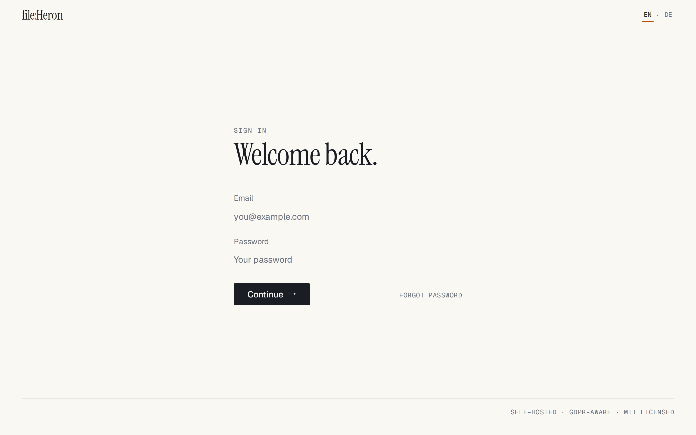
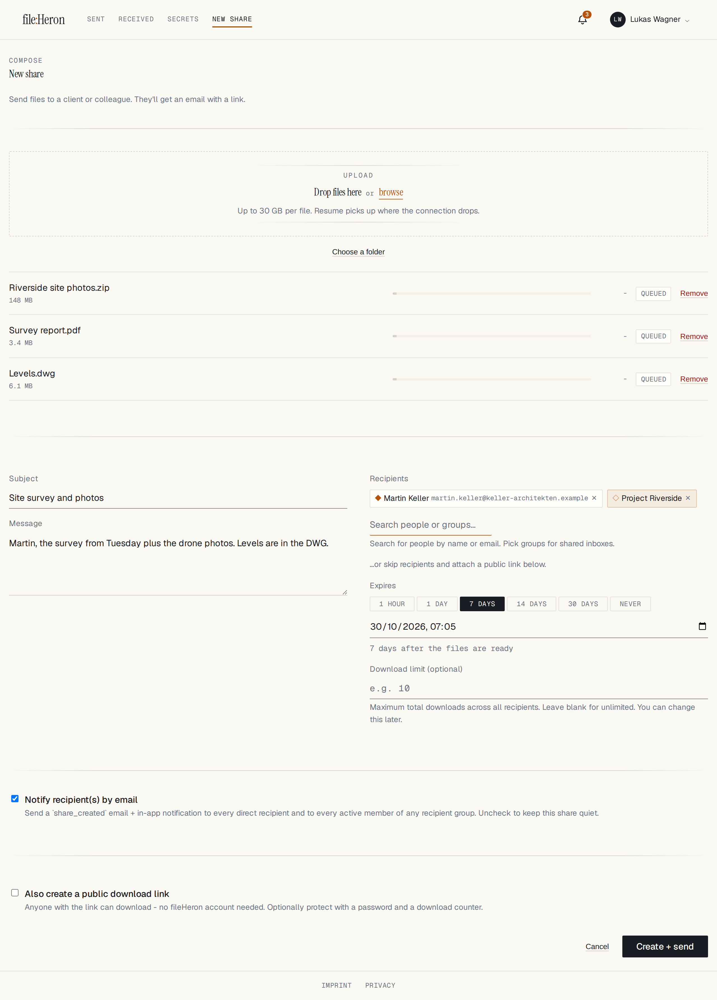
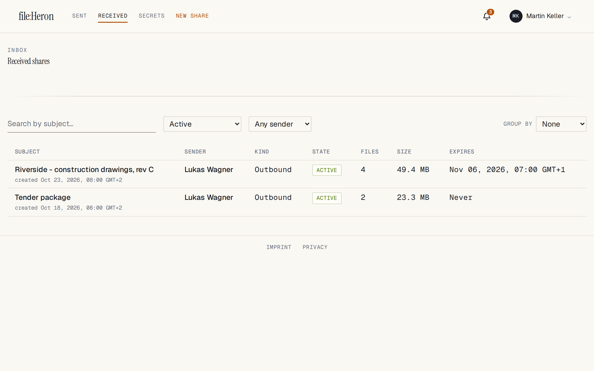
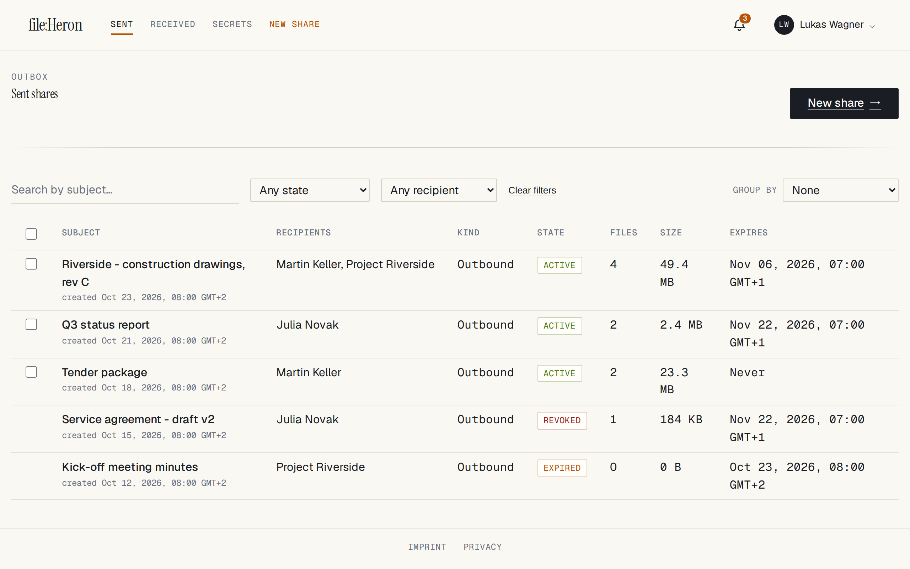
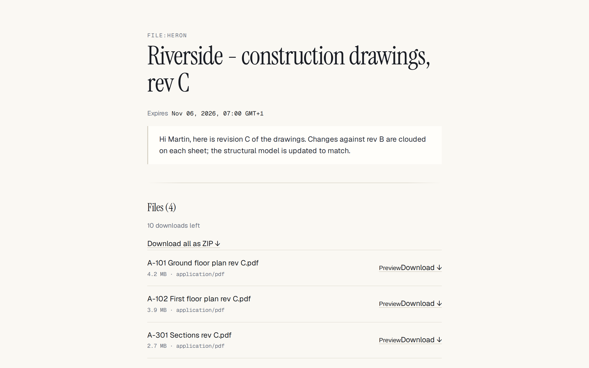
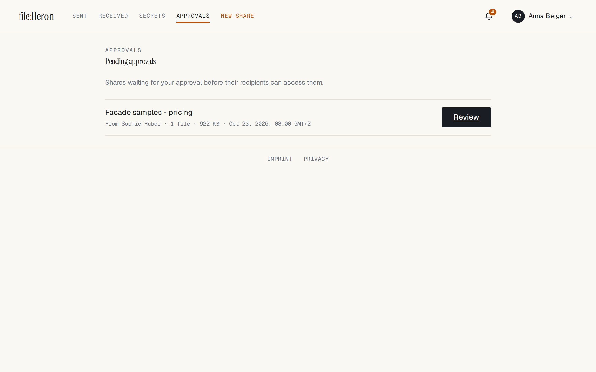
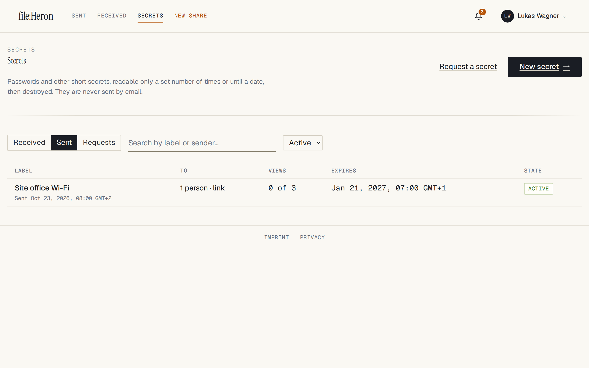
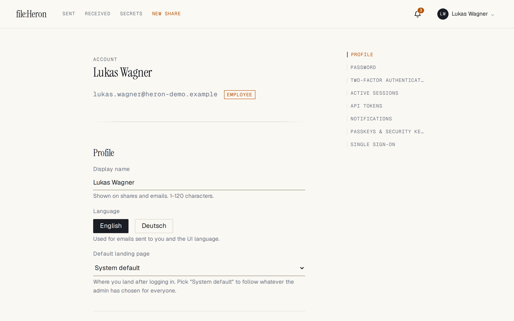

# Using file:Heron (end-user guide)

Part of the [file:Heron](../README.md) documentation.

Audience: anyone with an account - admin, employee, or client.

## Logging in

Open the app URL and you land on **Login**. Up to three ways to authenticate,
depending on what the admin configured:

1. **Email + password** (default). With 2FA on, submitting your password reveals one **Authentication code** field that accepts either a 6-digit TOTP code **or** a one-time recovery code (`XXXX-XXXX`) - no toggle. **Use a passkey instead** there takes a passkey registered on `/account` in place of the code (only one that verifies you with a PIN or fingerprint).
2. **Passkey** - only while an admin has switched **passkey sign-in** on (`/admin/settings/twofa`): **Sign in with a passkey** needs no email and no password, and browsers that can also offer your passkeys in the email field's autofill. A passkey then also counts as two-factor authentication: with a passkey and no authenticator app, the password step ends with **Use your passkey**.
3. **SSO (OIDC)** - one **Sign in with {provider}** button per enabled provider. With two-factor authentication set up, SSO ends on a second-factor page: your code, or your passkey while passkey sign-in is on.

Five wrong passwords in a row **locks the account for 15 minutes** (you get one email,
deduplicated to once per 6 h). After login you land on your **default landing page**
(set in `/account`).

## The page layout

- Top **brand mark** ("file:Heron") - back to home (or a static label if home is disabled).
- Centre nav: **Outbox**, **Inbox**, **New share** (plus **Approvals** if you're an approver, and **Secrets** when an admin has turned them on).
- Right: 🔔 **notification bell** (live via SSE), then your **name menu** (Account, Admin for admins, Sign out).
- One warm-amber accent on warm off-white; light theme only.

## Sending a share (`/share/new`)

1. **Pick recipients** - search shows who you may send to (employees see all employees + connected clients; clients see connected employees + any company-inbox group). Pick a **group** to address every current member (membership changes retroactively change who can read it).
2. **Drop files** - under 100 MB go via one multipart POST; larger use resumable TUS (close the tab and resume later from the same browser). Total is capped by your quota. **Folders** keep their structure: drop a folder, or use **Choose a folder**, and the share page lists the files under their folders, the public link page too, and **Download all (ZIP)** recreates the tree.
3. **Subject** (optional) - defaults to the first file's name.
4. **Expiry** (required) - a preset ("1 hour", "7 days", ...) counts from when the files are **ready to download**, so a long upload never eats into it; a date and time you type stays exact. A share is never expired while an upload into it is still running. After the expiry passes, the hourly cleanup deletes the bytes.
5. **Public link** (optional, if allowed) - set password, download-count limit, and "notify me on download". The URL is shown when the share is created and stays available on the share's page (owner and admins), with a QR code.

Recipients are emailed once the files can actually be downloaded - after the upload **and** the virus scan - so the link never answers "scan in progress". Files added to a share later are announced the same way.

Until the share can be sent, a list above **Create + send** says what is missing: no file yet, no recipient (or public link), or text typed into Recipients that was never picked from the list. An address with no account cannot be picked while *Recipients without an account* is off: clear the field (one click) and send the public link yourself - admins get a link to the switch.

**Recipients without an account** (off by default; *Admin → Sharing → Public links → Recipients without an account*). When an admin turns it on, anyone allowed to create public links can type an address that matches no one and pick *Send a download link to …*. The form then asks **Email the download link to these addresses** (ticked by default): ticked, the address is emailed the share's public link once the files have landed (and, if the share needs approval, once it is approved); unticked, it is only recorded and you send the link yourself. This is separate from *Notify recipient(s) by email*, which covers recipients with an account. No account is created, and the link's password is never in the mail - pass it on yourself. Everyone emailed shares the one link and its download counter. Under the approval scope *outbound to clients*, such a share is held for approval. The addresses are shown on the share page (to you, admins and approvers) until the share ends; the daily cleanup then forgets them, and the mail log keeps the record of the send for its retention window. A second switch makes the form ask whether to also **invite** each address as a client account (unticked by default); the link goes out either way.

## Receiving a share (`/inbox`)

The inbox lists shares addressed to you (directly or via a group). Per file you see a
**Download** button (scanned clean), "Scan in progress" (`425`), "Quarantined"
(`410`), or "Deleted" (`410`).

> **Client submissions are company-wide, by design.** A share a *client* sends in
> (an "inbound" share) is not addressed to one person: **every employee and admin
> can see and download it**, as can any other client who shares at least one group
> with the sender. Clients do not pick recipients — they send to the organisation.
> Outbound shares (staff → client) are the opposite: only the named recipients and
> the members of recipient groups can see them. If you need per-recipient isolation
> for inbound files, fileHeron is not a multi-tenant platform and does not provide
> it. Tell your clients what the audience is before you invite them. Downloads stream via kernel `sendfile()`; each is
logged (your IP, user, file, timestamp). A **Download all (ZIP)** option streams the
whole share as one archive - built on the fly, never cached to disk, and
**resumable**: an interrupted archive download continues from where it stopped
rather than starting over, and the resume is not charged a second time against
the share's download budget.

## Managing your shares (`/outbox`)

Click column headers to **sort**; **filter** by recipient/sender/state (default =
active only)/free text; **group** by recipient or group. On a share's detail page:
**Edit expiry**, **Expire now** (deletes bytes immediately), **Revoke**, **Add files**
(creator-only, while active), and the **Public link panel** (create / view / copy /
revoke).

## Public links (anonymous recipients)

The recipient opens `/d/{token}` - subject + file list, no login. A password prompts
to unlock first (10 wrong tries in 15 min *from at least 3 different addresses*
locks the **link** for everyone; a single address just gets rate-limited, so one
attacker cannot lock your recipients out). Each
download decrements the counter atomically; at zero the link refuses further
downloads. An interrupted download - a single file or the whole-share ZIP - can
be resumed without spending another unit, as long as the server can corroborate
that it really was in flight; a bare `Range:` header from a fresh connection is
charged like any other download.

## In-browser preview

Supported files get a **Preview** button (in the share view and on `/d/{token}`) that
renders inline instead of downloading: **PDF**, raster images (**PNG / JPEG / GIF /
WebP**), and **plain text** (any `text/*`, shown as source). Content is served from a strict allowlist with
`nosniff` + a restrictive CSP; SVG is never inline-rendered and HTML is served as
`text/plain`. Admins can disable the whole feature at *Settings → General → File
preview*.

**Preview does not consume the download-count budget and is not logged as a
download.** It delivers the original file, so anyone who can preview a file can
save a copy of it without moving the counter — a preview-capable recipient is
always someone already authorised to download. Treat `download_limit` as a cap
on counted *download* actions, not as a hard cap on retrievals: if you need the
latter for images, PDFs or text files, turn preview off at *Settings → General →
File preview*. (Once the budget is fully spent, preview is refused too.)

## Share approval (four-eyes)

Optional, admin-controlled. When enabled, a new share enters **pending approval** -
recipients aren't notified and can't access anything until an **approver** approves
(or rejects with a reason). Approvers get an **Approvals** queue; senders see "pending"
or the rejection reason + a **Resubmit** button (files kept). Configure who approves,
which shares need it, whether approvers may open files to review them, and whether
approvers' own shares auto-approve, at *Settings → Share approval*. Off by default.

**Approval covers the content, not just the share.** A share is judged when it is
created, but its owner can keep adding files afterwards - so a file uploaded into
a share that was *already* approved is held for its own decision instead of
riding on the earlier one. The share itself stays live throughout: everything
already approved keeps downloading, and any public link keeps working. Approvers
see "N file(s) added after approval" on the share and can **release** them to
recipients or **discard** them. For the same reason, a public link can no longer
be attached to a share after it has been approved (ask an admin), a share
cannot be approved while a file is still uploading, and an approval is refused if
the contents changed since the approver opened the page.

**A public link leaves the organisation.** With the scope *outbound to clients*,
a share that carries a public link - or goes to an address without an account -
is held like one addressed to a client. Attaching a link later to a live share
that this policy would hold needs an admin (`409 APPROVAL_REQUIRED`); an
approver whose own shares are exempt may still attach one to their own share.

## Secrets (`/secrets`)

Off by default (*Admin → Sharing & files → Secrets → Policy*); once an admin turns
it on, a **Secrets** link appears in the header. A secret is a password, a key or
any short text (up to 10,000 characters) for named people or a link. It can be
read a set number of times and/or until a date, and is then destroyed. Its text is
never put in an email: recipients are told that a secret is waiting and open it in
file:Heron.

**Sending** (`/secrets/new`):

1. **The secret** - type or paste it, or **Generate a password** (length and character classes; made in your browser).
2. **Label** (optional) - the only part anyone sees before revealing it, and the only part in notifications and mail. Don't put the secret there.
3. **Recipients** - people and groups, as for a share. If the admin allows it, staff can also type an **email address without an account** (each address gets its own link, mailed to it) and **create a link** to pass on themselves (chat, phone; with a QR code). Clients can send only to the employees they are connected to.
4. **Limits** - a view limit, an expiry, or both (at least one); whichever comes first ends the secret. The form starts at 1 view and 7 days. How the views count: **Each person** (everyone who can read it gets them, each group member too) or **All together** (one pool; once used, it is gone for all). With a group among the recipients there is a third choice, **Each recipient**: every person, address and the link gets the views, and a group's members share theirs, so the first member's view can use them up for the rest.
5. **Passphrase** (optional) - part of the encryption, not just a prompt: without it nobody can open the secret, not even the server's operator, and if it is lost the secret cannot be recovered. Tell the recipients another way. You may choose that too many wrong passphrases destroy the secret for that recipient.
6. **Notify me when it is viewed** (off by default) - a notice for each view, and one when the secret is used up or expires unread.

**Receiving.** A secret addressed to you is under **Secrets → Received**, and you
are notified. Only the **Reveal** button uses a view: opening the page or a link
costs nothing (mail scanners open links before people do). When it was the last
view the page says so - copy it then. A group member can read a secret if they
were in the group when it was sent **and** still are. A wrong passphrase never
uses a view. Repeated wrong passphrases are slowed down, and a link is locked for
a while only when they come from several addresses, so one person guessing cannot
lock the real recipient out. If the sender or the admin chose so, too many wrong
passphrases instead destroy the secret for that recipient.

**Status.** Under **Secrets → Sent** the sender sees each secret's views left,
who viewed it and when (with the address for a view through a link or an email
link), and can **Burn now**, copy their links again, **replace the link** (a new
URL with a fresh count) or remove it. Neither the sender nor an admin can read
the secret itself. A link opens `/s#...`: the part after `#` never leaves the
browser, so the token reaches no proxy or access log.

**When a secret ends** - its views used, its expiry passed, or burned - its
encrypted text, its key and its links are deleted from the database at once. The
record (label, recipients, view log) is kept for 90 days (*Data retention &
storage*, `0` keeps it), then pruned.

**Requesting a secret** (`/secrets/requests/new`, or *Request a secret* on the
Secrets page). Instead of sending, you ask someone for a password: say what you
need (and an optional note - both are shown to whoever may answer, so never put a
secret there), whom you ask (people, groups, addresses without an account - each
mailed its own answer link - and/or a link you pass on yourself, under the same
rules as sending), how long the request stays open, and how the answer may be
read (views and/or how long after it arrives). The person asked types the secret
on the request page (or on the `/r#...` page behind a link, without an account),
optionally with a passphrase of their own. **The first answer closes the
request**: every other link stops working, and the answer arrives as a secret that
only you can open (you are told in-app and by mail). If you set a **passphrase**
when asking, the answer is encrypted to it: nobody, the server included, can open
it without that passphrase, and nobody has to pass a passphrase to you. Requests
are under **Secrets → Requests** (*Asked by me* / *Asked of me*); you can cancel an
open one, copy its links again, and discard the answer unread. An unanswered
request expires at its time and you are told.

How a secret is protected

- **Encryption.** Each secret's text is encrypted with a key made for it alone. That key is wrapped by the instance key (derived from `JWT_SECRET`, like TOTP secrets) and, with a passphrase, by an Argon2id key derived from the passphrase underneath. The passphrase is stored nowhere. `backend/scripts/rotate_jwt_secret.py` re-wraps the outer layer without needing any passphrase.
- **Only recipients read it.** The text is in exactly one response: the reveal. Audit rows, webhooks and logs carry the label, ids and counts - never the text, a token or an address (the audit log counts addresses). Notifications and mail never carry the text; the sender's "viewed" notice names who viewed it - the person, or the address or link and its IP.
- **Counting.** A view is claimed by one conditional `UPDATE ... WHERE views_used < limit` while the secret's row is locked, so two people revealing the last view at once cannot both get it.
- **Tokens.** A link token is 43 random characters; the server stores its SHA-256 for lookup and an encrypted copy so the sender can copy the link again (showing it again is audited). The page posts the token in a request body, never in a URL, and the mail log masks it (`/s#<redacted>`, no resend).
- **Ending is final.** Burned, expired and used-up secrets cannot be recovered from the database. A configuration import burns every active secret, and erasing a user deletes the secrets they sent.
- **Requests.** An answer to a request is an ordinary secret whose only reader is the requester - the same encryption, counting and shredding. The requester's passphrase is turned into a key pair when asking and only the **public** key is kept; the answer is sealed to it inside the instance layer, so opening it needs the passphrase again. The first answer is claimed by one conditional `UPDATE` while the request row is locked, so two answers cannot both land. Answer links ride `/r#<token>` like secret links.
- **API.** `/api/secrets` with six token scopes: `secrets:send` (also: answering a request), `secrets:read` (metadata, never the text), `secrets:reveal` (the text), `secrets:manage` (burn; create, replace or remove the link), `secrets:links` (read the links back) and `secrets:request` (ask for a secret: `/api/secret-requests`). Link and address holders use `POST /api/public/secrets/peek` (free) and `/reveal`, and `POST /api/public/secret-requests/peek` (free) and `/answer`.
- **Desktop client.** A **Secrets** tab, shown when the server has secrets switched on: received, sent and requests, sending and requesting, revealing (masked until *Show*; *Copy* works while masked), answering a request, and the sender's status, links and *Burn now*. Links and addresses (the `/s` and `/r` pages) are opened in a browser.

## Account page (`/account`)

A single scrollable page (left quick-nav with scroll-spy):

- **Profile** - display name + UI language (EN/DE), save instantly.
- **Default landing page** - where you go after login.
- **Password** - checked against HaveIBeenPwned (k-anonymity, no plaintext sent).
- **Sessions** - every active session (browser + last-seen IP, 24-h timestamps); revoke any. Per-user cap (default 10): an 11th sign-in evicts your oldest and notifies you.
- **Two-factor (TOTP)** - QR + secret, confirm, get 10 one-time recovery codes.
- **Recovery codes** / **Passkeys** - regenerate codes; register/remove WebAuthn authenticators. While passkey sign-in is on, a passkey kept on the device is marked **Signs in without a password** - keep a second one, or an authenticator app, in case you lose that device.
- **SSO connections** - connect/disconnect OIDC providers (refuses on email mismatch).
- **Email address** - change your sign-in email (if the admin's [email-change policy](admin-guide.md#policies--settings) allows it), via a confirm-by-email flow.
- **Notifications** - per-category channel (off / email / in-app / both). Security-critical types (password reset, sign-in alerts) are shown but **locked on**.
- **API tokens** - if policy allows: **Full access** or **Limited** (tick exactly what it may do across *Sharing*, *Files* and *Secrets*); a limited token is refused (`403 INSUFFICIENT_SCOPE`) outside its scopes. Plaintext shown once.

Every email carries a **Manage subscriptions** footer link (and ordinary
notifications a one-click **Unsubscribe**) that works **without logging in** via a
signed token, plus native RFC 8058 one-click unsubscribe. If a 2FA enforcement policy
covers your role/group, navigation forwards you to `/account/2fa` until you enrol.
